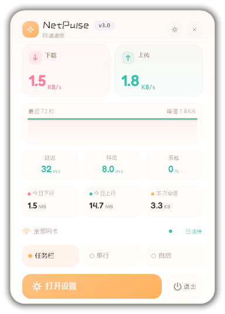
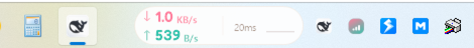
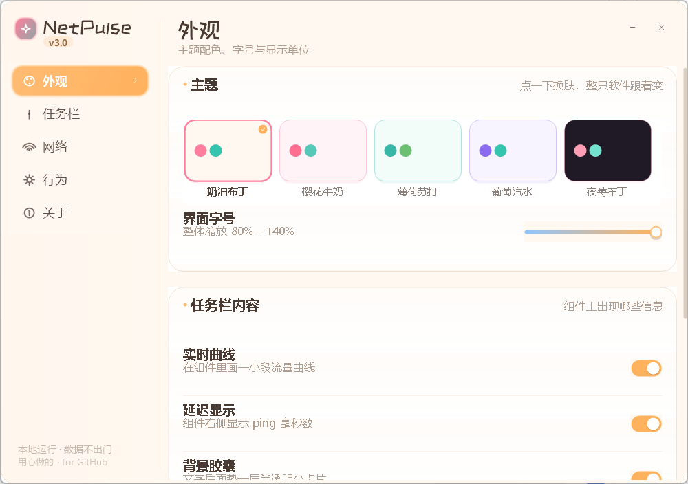
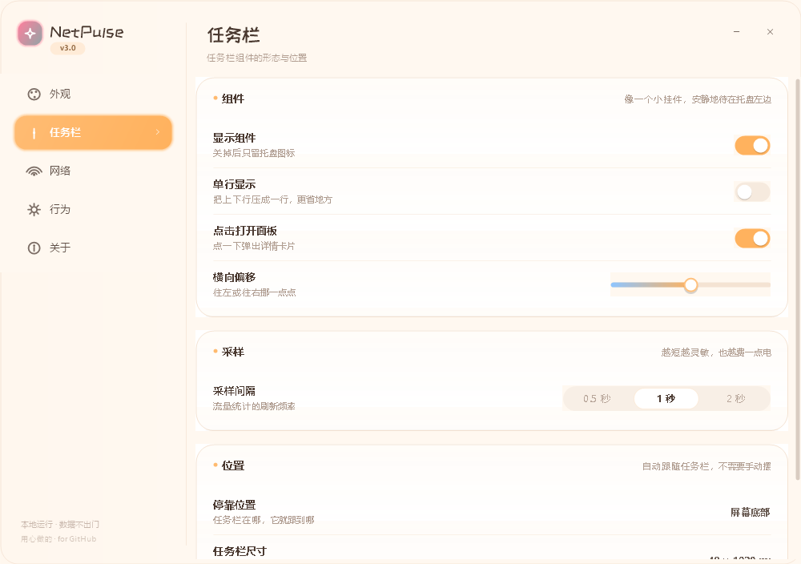
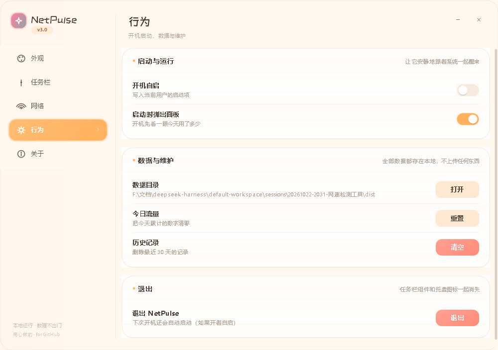
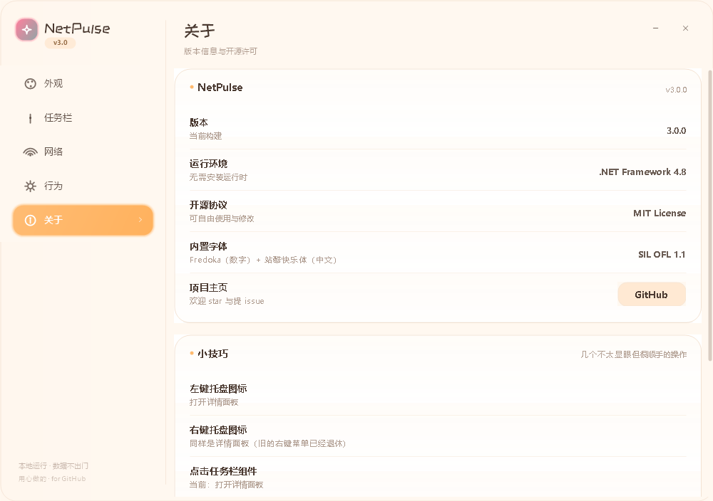

# NetPulse · 任务栏网速浮窗

> 把「现在的网速」放到任务栏上，一眼就能看到 —— 可爱、轻巧、单文件、零依赖。

一个 Windows 任务栏网速监视小工具。它不是一个占地方的大窗口，而是一枚贴在托盘左边的小胶囊：
实时上下行速率、迷你流量曲线、延迟 / 抖动 / 丢包、今日流量、网卡状态，全都在任务栏那一小块地方。

点一下 → 弹出可爱面板；设置里 5 套配色、界面字号、组件大小、单行显示、胶囊背景，随便调。




---

## 特性

**任务栏原生集成**

- 贴在托盘图标左边，**跟随任务栏**：底部 / 顶部 / 左侧 / 右侧四种停靠都支持
- 任务栏自动隐藏、分辨率 / DPI 变化、资源管理器重启、全屏游戏 —— 都会自动让位并恢复
- 用窗口 owner 关系挂到 `Shell_TrayWnd` 上，所以**不会被任务栏盖住**（不是靠反复抢 `HWND_TOPMOST`）

**能看的都在上面**

- 双行 / 单行两种排布，数字固定列宽、跳动不抖
- 可选迷你曲线（对数刻度，小流量也看得见）、胶囊半透明底
- 延迟、抖动、丢包率（ICMP 60 次滑窗，不是平均值的假平滑）
- 今日下行 / 今日上行 / 本次会话，跨天自动翻页，保留最近 30 天
- 当前网卡名、连接状态、协商速率
- 托盘图标同步画成一根会长的柱状图，速率越高柱子越高

**可爱但不幼稚**

- 5 套配色：奶油布丁、樱花牛奶、薄荷苏打、葡萄汽水、夜莓布丁（深色）
- 圆角 18–26px、柔和阴影、马卡龙撞色、hover 微动效
- 字体：数字用 [Fredoka](https://fonts.google.com/specimen/Fredoka)，中文标题用 [站酷快乐体](https://fonts.google.com/specimen/ZCOOL+KuaiLe)（都只内嵌子集，合计 ~145 KB）
- 整体字号可 80%–140% 缩放

**轻**

- 单个 `NetPulse.exe`（约 300 KB），不装运行时、不写注册表（除非你开自启）、不联网上报
- 空闲 CPU ≈ 0（内容没变化就不重绘），内存约 40 MB，GDI 对象稳定
- 配置是可读的 `netpulse.ini`，流量记录是 `data/traffic.json`，都在 exe 旁边，拷走就能带走

---

## 快速开始

1. 到 [Releases](../../releases) 下载 `NetPulse-3.0.0-win.zip`，解压到任意文件夹（别放在 `C:\Program Files` 这种需要管理员权限的位置）。
2. 双击 `NetPulse.exe`。任务栏上会出现小胶囊，托盘出现图标。
3. 需要开机自启：设置 → 行为 → 开机自启。

**系统要求**：Windows 10 1903+ / Windows 11，x64 或 ARM64（x64 模拟）。依赖 .NET Framework 4.8 —— Win10 1903 之后和 Win11 都是系统自带，不用另外装。

**卸载**：退出程序，删掉文件夹即可。开过自启的话，设置里关掉自启会同时清掉注册表项。

---

## 怎么用

| 操作 | 结果 |
| --- | --- |
| 左键点任务栏胶囊 | 弹出详情面板 |
| 左键 / 右键点托盘图标 | 同上（旧的右键菜单已退休） |
| 面板里点「任务栏 / 单行 / 自启」 | 即时切换，不用进设置 |
| 开机自动弹出的面板 | 7 秒后自己收起来，鼠标一动就留住 |
| 面板里点齿轮 | 打开设置 |
| 设置窗口 Esc | 关闭 |

## 设置项

<details>
<summary>外观</summary>

| 项 | 说明 |
| --- | --- |
| 主题 | 5 套配色，点一下即时换肤 |
| 界面字号 | 80%–140%，缩放面板与设置窗口（不再影响任务栏组件） |
| 实时曲线 | 组件里画不画迷你曲线 |
| 延迟显示 | 组件上显不显示 ping 毫秒数 |
| 背景胶囊 | 组件背后那层半透明小卡片 |
| 速率单位 | 自动 / B/s / KB/s / MB/s |

</details>

<details>
<summary>任务栏</summary>

| 项 | 说明 |
| --- | --- |
| 组件大小 | 70%–140%，只缩放任务栏那一小块，和界面字号无关 |
| 显示组件 | 关掉后只剩托盘图标 |
| 单行显示 | 把上下行压成一行，更省地方 |
| 点击打开面板 | 点组件是否弹面板 |
| 横向偏移 | −40…+40 px，往左或往右挪一点 |
| 采样间隔 | 0.5 / 1 / 2 / 5 秒 |
| 停靠位置 / 任务栏尺寸 | 只读，实时显示系统数值 |

</details>

<details>
<summary>网络</summary>

| 项 | 说明 |
| --- | --- |
| 统计范围 | 全部网卡合计，或指定某一块（自动过滤 QoS / WFP / WAN Miniport 等虚拟接口） |
| 当前状态 / 链路速率 | 只读 |
| 开启检测 | 关掉后不再发探测包 |
| 探测目标 | 阿里 / 腾讯 / 百度 / Google / Cloudflare，或自定义域名、IP |
| 探测间隔 | 0.5 / 1 / 2 / 5 秒 |

</details>

<details>
<summary>行为</summary>

| 项 | 说明 |
| --- | --- |
| 开机自启 | 写 HKCU\...\Run |
| 启动时弹出面板 | 开机先看一眼今天用了多少 |
| 数据目录 | 打开配置所在文件夹 |
| 今日流量 / 历史记录 | 清零 / 删除最近 30 天 |

</details>

---

## 设置界面

| 外观 | 任务栏 |
| --- | --- |
|  |  |

| 网络 | 行为 |
| --- | --- |
|  |  |



---

## 实现要点（给想改代码的人）

- **不会被任务栏盖住**：`SetWindowLongPtr(hwnd, GWLP_HWNDPARENT, Shell_TrayWnd)` 建立 owner 关系。
  被拥有的窗口在 z 序上恒定位于 owner 之上，这是窗口管理器的文档化行为；比起每秒几十次
  `SetWindowPos(HWND_TOPMOST)` 抢置顶，既稳又不抖。
- **像素级圆角**：`WS_EX_LAYERED` + `UpdateLayeredWindow`，整个组件画在 32bpp 离屏位图上，
  只把非透明像素贴到屏幕上，所以边缘是真的抗锯齿圆角，而不是抠一个 Region。
- **网卡计数**：`GetIfTable2` + `MIB_IF_ROW2`。结构体偏移不硬编码，启动时用 `Marshal.OffsetOf` 现算，
  换 Windows 版本也不会读错；按 `OperStatus == 1` 且非回环累加，QoS / WFP / WAN Miniport / 蓝牙
  这些虚拟小端口按名字过滤掉。
- **延迟统计**：`IcmpSendEcho`，32 字节载荷、600 ms 超时，保留最近 60 次往返算 RTT / 抖动 / 丢包。
  抖动是相邻两次 RTT 差值的平均，丢包是被丢包数占比。
- **不卡顿的做法**：采样线程独立的 `ManualResetEvent` 等待（不会空转）；组件和面板只在
  「会画出来的内容」真的变化时才重绘；阴影预渲染成位图缓存，不在每帧画 14 圈路径；
  字体、画刷全部缓存复用。
- **静态字体内嵌**：字体以资源形式内嵌，运行时按内容哈希解压到 `%TEMP%\NetPulse`，
  用私有 `FontFamily` 加载，不污染系统字体库。

---

## 从源码构建

```powershell
# 需要 Windows + .NET Framework 4.8（不用装 .NET SDK，脚本会退回内置 Roslyn 编译器）
.\build.ps1            # 输出 dist\NetPulse.exe
.\build.ps1 -Run       # 编译完直接运行
.\publish.ps1          # 打包 dist\NetPulse-3.0.0-win.zip
```

- 有 `dotnet` + `src\NetPulse.csproj` 时走 `dotnet build`；没有就走内置的 Roslyn `csc.exe`。
- 字体子集重建（可选，需要 `fonttools`）：

  ```powershell
  python -m venv .venv
  .\.venv\Scripts\pip install fonttools brotli
  .\.venv\Scripts\python tools\make-font.py   # 生成 assets\digitfont.ttf / assets\cjkfont.ttf
  ```

- 自检：`NetPulse.exe --selftest`，不弹界面，跑一遍配置读写 / 流量存储 / 自启 / 格式化 / 网卡枚举 / 采样，
  结果写到 `data\selftest.log`，退出码 = 失败项数量（0 表示全绿）。
- 调试开关：`NP_PERF=1` 启动后每 3 秒往 `data\netpulse.log` 写一行 CPU / 线程占用统计。
- 另有两个给截图和自动化用的小参数：`--page=N` 直接打开第 N 页设置，`--shot=路径` / `--shotpanel=路径`
  把自己渲染成 PNG 后退出（仓库里的截图就是这么生成的，不依赖桌面截图，也不怕被别的窗口挡住）。

### 目录

```
src/
  Program.cs            入口：单实例、DPI、异常兜底、命令行参数
  App/
    PulseApp.cs         ApplicationContext：托盘 + 组件 + 面板 + 设置串起来
    Conf.cs             路径、ini 读写、格式化、自启
    Themes.cs           5 套主题 + 数字格式化
  Core/
    Ifaces.cs           GetIfTable2 封装与虚拟网卡过滤
    Monitor.cs          采样线程 + ICMP 滑窗
    TrafficStore.cs     今日 / 历史流量（JSON）
  Ui/
    LayeredForm.cs      分层窗口基类 + 弹层
    TaskbarWidget.cs    任务栏组件
    PanelForm.cs        详情面板
    SettingsForm.cs     设置窗口（5 页）
    Controls.cs         圆角开关 / 滑杆 / 分段 / 卡片 / 行
    Paint.cs            圆角、渐变、阴影、矢量图标
    UiFont.cs           内嵌字体加载与缓存
    TrayIcon.cs         托盘图标
  Interop/Native.cs     P/Invoke 层
assets/                 图标、manifest、字体子集
tools/
  make-font.py          字体子集生成
  fontsrc/              原始字体（OFL）
  dev/                  截图 / 探针小脚本（开发自用，非运行时依赖）
```

---

## 常见问题

**托盘图标被折叠进 `^` 里看不见？**
Windows 11 默认折叠新图标。把它从 `^` 面板拖到任务栏上即可，系统会记住。

**任务栏自动隐藏时组件去哪了？**
一起隐藏。鼠标移到屏幕边缘、任务栏滑出来时，组件会跟着回来。

**为什么延迟数字比较大？**

默认探测目标是 `1.1.1.1`（Cloudflare 的公共 DNS，全球任播，通常 10–50 ms）。如果换成国内节点（比如 `223.5.5.5`），在海外访问会多出两百多毫秒——这不是软件慢，是包真的绕了半个地球。在设置 → 网络 → 探测目标里挑一个离你近的即可。

**为什么延迟一直是「--」？**
探测包被防火墙/路由拦了。换一个探测目标（比如 `1.1.1.1`）或者关掉延迟检测。

**会不会被判断成外挂 / 被反作弊拦？**
它只读 `GetIfTable2` 的网卡计数器并发 ICMP，不注入任何进程、不读游戏内存。全屏游戏时还会自动隐藏。

**杀毒软件报未知文件？**
单文件、无数字签名的小工具常被启发式误报。所有源码都在这里，可以自己 `build.ps1` 编译。

**数据会上传吗？**
不会。除了你自己设的 ICMP 探测目标，程序没有任何外发请求。

---

## 许可

- 代码：[MIT](LICENSE)
- 内置字体子集：SIL Open Font License 1.1，详见 [THIRD-PARTY.md](THIRD-PARTY.md)

欢迎 issue / PR。改 UI 之前建议先看一眼 `src/Ui/Paint.cs` 和 `Controls.cs`，圆角、阴影、控件都在那儿。
